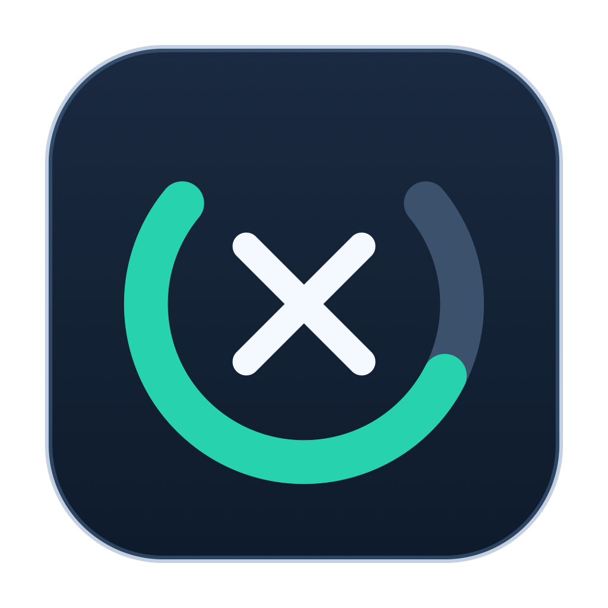

# xCleaner

<div align="center">



# xCleaner

**Ultra-Lightweight, Native Apple Silicon Storage Analyzer, App Uninstaller & Safe Cleanup Assistant.**

[-000000.svg?logo=apple&style=flat-square)](https://github.com/asiddeenmuhammad/xCleaner)
[](https://github.com/asiddeenmuhammad/xCleaner)
[](https://swift.org)
[](LICENSE)
[](https://github.com/asiddeenmuhammad/xCleaner/actions)
[](https://github.com/asiddeenmuhammad/xCleaner)

**[🌐 Visit Product Website & Live Docs](https://asiddeenmuhammad.github.io/xCleaner/)**

</div>

---

## ⚡ What is xCleaner?

**xCleaner** is a blazing-fast (`~4.7 MB`), pure Apple Silicon (`arm64`) macOS application that replaces manual CLI disk-hunting scripts (`df`, `du -sh *`, `ncdu`, `diskutil`, `tmutil`, `docker system df`) with an intuitive, native UI. 

Unlike bloated Electron utilities or aggressive cleaners that corrupt caches, xCleaner enforces a **100% user-driven decision contract**:
- **Zero Silent Deletions**: Every deletion is explicitly staged, audited, and moved to Trash by default.
- **Default Toolchains Are Locked**: Your active shell Node.js runtime (`nvm alias default` / `NVM_BIN`), latest Gradle, and stable Android SDK versions are locked against accidental removal.
- **5-Layer Safety Guard**: Hardcoded SIP system and credential protection, live running-app locks (`NSWorkspace` + Chromium `SingletonLock`), and persistent **`Pin to Keep`** memory.

---

## 🚀 Key Features

### 1. Storage Pulse
- Real-time APFS container breakdown (`User & App Data`, `APFS VM Swap`, `macOS System + Preboot`, `macOS Purgeable`, and `Raw Free`).
- TCC Full Disk Access privacy gap estimator with 1-click deep-link to macOS Privacy Settings.
- CLI maintenance actions: `brew cleanup`, Xcode simulator pruning, and local Time Machine snapshot thinning via `tmutil`.

### 2. App Uninstaller & Leftover Sweep
- Discovers installed apps in `/Applications` and `~/Applications`, pairing them with their associated `~/Library` caches, containers, and preferences.
- 3 Granular cleanup actions per app:
  - **`Clean Caches`**: Stages regenerable caches/logs while keeping app settings and binaries intact.
  - **`Reset App`**: Factory reset: stages caches, support folders, and preferences while keeping the app in `/Applications`.
  - **`Uninstall`**: Stages the `.app` bundle and all associated user leftovers for clean removal.
- **Uninstalled Leftover Sweep**: Detects orphaned directories left behind by previously trashed apps (e.g. uninstalled VS Code, Cursor, Filmora).

### 3. Smart Junk & Monorepo Scanner
- Scans `~/Library/Caches`, `~/Library/Logs`, and abandoned auto-updater staging bundles (`*.ShipIt`, `*-updater`).
- Surgical browser & IDE cache isolation: cleans Chromium `Service Worker/CacheStorage` without touching `Cookies`, `Login Data`, `Bookmarks`, or `History`.
- Depth-7 monorepo project artifact finder (`node_modules`, `dist`, `android/app/build`, `.next`, `.build`, `target`, `venv`, R `renv`) with interactive staleness filters (`All`, `>30d`, `>60d`, `>90d`, `>180d`).

### 4. Side-by-Side Toolchains & Remote SSH Docker
- Compares installed versions of Gradle, Android SDK/NDK/build-tools (highlighting `-rc*` previews), Node.js `nvm`, and Puppeteer/Playwright browsers.
- Automatically locks your default & active versions with a teal lock icon while flagging older versions actively referenced by local projects in `gradle-wrapper.properties` or `.nvmrc`.
- Discovers remote build servers in `~/.ssh/config` and runs non-interactive BuildKit and dangling image prunes over SSH without touching running containers or volumes.

### 5. Squarified Treemap & Visual Explorer
- Synchronized `ncdu`-style ranked size-bar list paired with a SwiftUI `Canvas` squarified treemap.
- Cycle-immune symlink traversal that never double-counts disk allocations or loops infinitely.

---

## 📦 Download & Installation

Download the latest pre-compiled disk image from **[Releases](https://github.com/asiddeenmuhammad/xCleaner/releases)**:

1. Open **`xCleaner.dmg`**.
2. Drag **xCleaner** into your **Applications** folder.
3. Launch **xCleaner** and grant notification permissions.

---

## 🛠️ Building from Source (No Xcode.app Required)

Requires macOS 14+ on Apple Silicon with Apple Command Line Tools (`swift --version` >= 6.0):

```bash
# Clone the repository
git clone https://github.com/asiddeenmuhammad/xCleaner.git
cd xCleaner

# Run automated unit & safety integration tests
make test

# Build ad-hoc signed Apple Silicon bundle (dist/xCleaner.app)
make app

# Package distributable drag-and-drop disk image (dist/xCleaner.dmg)
make dmg

# Launch the app directly
make run
```

---

## 🛡️ The 5-Layer Safety Contract

| Layer | Mechanism | Protection Scope |
|---|---|---|
| **1. Hard System & Key Blocklist** | `SafetyPolicyEngine` | Blocks `/System`, `/Library`, `/usr`, `/Applications`, `.git`, `*.pem`, `*.key`, `Docker.raw`, and iCloud/CloudStorage mounts. |
| **2. 4-Tier Advisory Engine** | `AdvisoryEngine` | Classifies items as **Safe** (green), **Caution** (orange), **Warning** (red - requires explicit acknowledgment), or **Protected** (locked). |
| **3. Live Process Lock Guard** | `LiveRunningAppGuard` | Checks `NSWorkspace` running processes and Chromium `SingletonLock` files before staging. Offers 1-click **Quit App** action. |
| **4. Default Version Locking** | `ToolchainVersionScanner` | Disables removal of active/default toolchain runtimes (`nvm alias default`, active `NVM_BIN`, latest stable Gradle, current Android SDK). |
| **5. Non-Destructive Trash** | `CleanupService` | Moves files to macOS Trash via `NSWorkspace.shared.recycle` by default. Full audit trail logged to `cleanup-history.jsonl`. |

---

## 🏷️ Credits & License

- Designed and built with **Google Antigravity**.
- Distributed under the **[MIT License](LICENSE)**.
